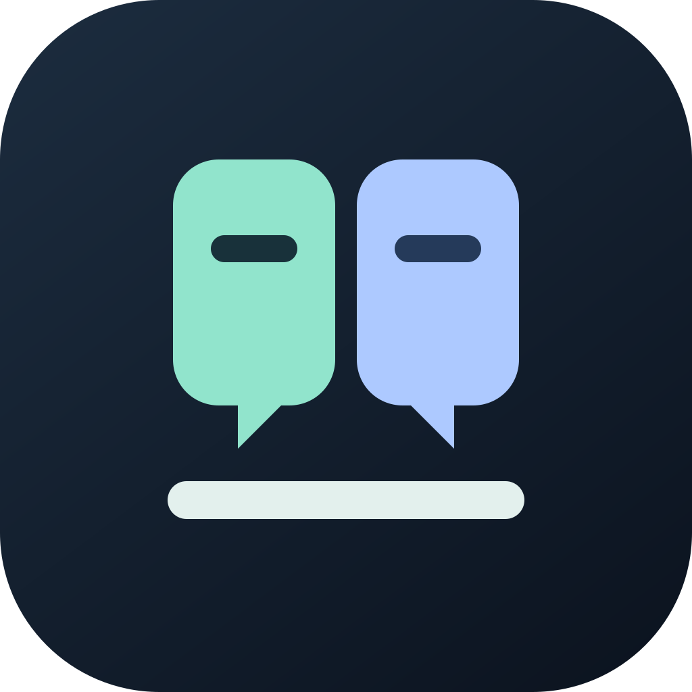

# 同桌 DeskMate



**你的 AI 同桌。**

同桌是一个本地优先的桌面 AI 工作台，把不同厂商的 CLI Agent、项目、会话、文件和终端放进同一个窗口，让 AI 助手和你一起工作。

你可以继续使用各厂商已有的订阅和登录。每个 Agent 由自己的 CLI 执行任务、管理认证并提供可用模型；同桌负责连接它们、组织工作和保存本地记录。普通 Agent 会话不需要额外注册同桌账号或配置同桌模型网关。

项目基于 [上游 Atlas](https://github.com/pacifio/atlas) 开发，由 [gggab/atlas](https://github.com/gggab/atlas) 维护，使用 Tauri 2、React 19 和 Rust。

## 能做什么

- **多个 Agent，一张工作台**：安装或接入已有 CLI，在不同项目和独立会话中并行工作。认证、模型选择和会话恢复以 Agent 的 ACP 能力协商结果为准。
- **完整的会话体验**：流式消息、操作审批、取消、历史记录、归档，以及支持相应能力的 Agent 会话恢复。
- **个人助手**：侧边栏固定聊天窗口，无需打开工作项目；持续保留聊天记录，保存个人事实和偏好，通过聊天登记提醒，建议计划需在卡片中确认。Agent 的连接由后台管理。
- **项目工具随手可用**：文件浏览与编辑、终端、本地会话记录和检查点；历史卡片展示状态、用时及已记录的 Git 分支。
- **共享本地记忆**：在项目范围内保存决策、事实、计划和工作进展，通过本地 MCP 服务供支持 HTTP MCP 的 Agent 读取与写入。
- **本地代码检索**：文本、文件、符号、调用关系及语义检索；嵌入模型需要明确下载，检索会避开被忽略的文件与敏感文件。
- **浏览器协作**：通过 DeskMate Browser 扩展控制 Chrome 或 Edge，在独立任务标签页中工作，支持网站授权、暂停、接管和继续执行。
- **受控 SSH**：管理连接和项目关联，保留执行记录；凭据存放在操作系统凭据库中，连接使用需要用户授权。

项目还保留了本地知识笔记、画布、PDF 与文档预览等功能。可选的自带 API 密钥（BYOK）研究、分析和记忆对话独立于普通 CLI 会话。

## 开始使用

### 从源码运行

先安装对应平台的 Tauri 开发环境：

| 平台 | 主要依赖 |
|---|---|
| Windows | MSVC C++ Build Tools、Windows SDK、WebView2 |
| macOS | Xcode Command Line Tools |
| Linux | GTK、WebKit 及 Tauri 所需系统库 |

工具版本以仓库的 `mise.toml`、`package.json` 和 `rust-toolchain.toml` 为准，当前固定为 Bun 1.4.0、Rust 1.99.0。Node 使用 `mise.toml` 中固定的版本；打包浏览器运行时需要带有 LICENSE 文件的官方 Node 发行版。

```sh
git clone --branch develop https://github.com/gggab/atlas.git
cd atlas
bun install --frozen-lockfile
bun run dev:app
```

源码开发版显示为 **同桌 DeskMate Dev**，使用独立的开发数据目录。日常开发优先使用 `dev:app`。

### 接入你的 Agent

1. 在设置中安装一个外部 Agent，或确认接入同桌检测到的已有 CLI。
2. 完成该 CLI 对应厂商的登录与认证。
3. 打开本地项目，选择 Agent 和它提供的模型，开始会话。

新数据配置中不会预装可执行 Agent。检测到 CLI 只代表可以接入，需要确认后才会成为已安装 Agent。订阅权限、模型可用性和费用由对应厂商决定。

### 启用浏览器操作

内置 Browser 标签页已移除，网页操作统一通过 Chrome／Edge 扩展完成。已有知识笔记和旧浏览器配置数据保留在本地。

在 **设置 → 浏览器控制（Settings → Browser control）** 中安装并授权 DeskMate Browser，选择 Chrome 或 Edge 的浏览器配置。桌面应用需要保持运行。

首次访问网站需要授权；你可以暂停控制或接管页面。每个会话会复用自己的标签组和保留页面，结束时默认关闭新建的任务页面，保留明确标记的交付或交接页面，以及原有日常标签页和登录状态。

Local file pages and website file uploads require **Allow access to file URLs** in the browser's extension details. This browser setting is separate from website approval; the extension adds no upload button.

扩展有独立版本和商店审核流程。仓库中的扩展名称已改为 DeskMate Browser，商店展示名称以已审核版本为准；现有 Chrome／Edge 扩展 ID 保持兼容。桌面应用发布不代表扩展已经发布。

## 本地数据与记忆

点击侧边栏 **个人助手**，选择已接入的 Agent 后直接发送消息。这里始终是同一个窗口，本地记录无需连接 Agent 即可查看。
个人助手复用 Agents 的对话界面、输入框、模型选择与权限提示；记忆和计划在右上角的“记忆与计划”面板中查看，默认收起。
直接说“每周四中午12点前要写周报”时，助手会按默认规则登记每周四11:30的提醒，任务中心可查、可修改。
有明确截止时刻默认提前30分钟，只有日期默认当天9点；使用电脑当前时区并在创建时固定。缺日期、对象不清或规则冲突时先询问。
默认提醒时间已过时跳过本次并明确告知；周期任务从下一个正常时间继续，不自动补发。
可以说“记住房租每月 10 日交”，或明确给出提醒要求。聊天中的记忆工具要求 Agent 支持 HTTP MCP；聊天登记提醒还需在任务中心明确开启 Agent 任务工具，连接期间更改工具开关需重启应用生效。
日常直接说“我的房租每月 10 日交”也会触发助手尝试提炼稳定信息，不必每次说“记住”。
明确事实可自动保存，含糊信息先成为待确认记忆；可能漏记，可从自己的消息下方点“保存为个人记忆”并编辑确认。
每次发送会主动提供少量核心与主题相关记忆，最多18条、记忆资料块最多4000字符；被省略或截断的内容可由工具补查。置顶的核心记忆最多5条。
删除会阻止旧回合直接写回同一条目；重新记住需在手动编辑器明确确认。保存或更正记忆不自动创建、更改提醒。
底层执行上下文会自动尝试重连；Agent 不支持恢复时会在后台建立新的执行上下文并提示限制，已有聊天、记忆和计划保留。登录或网络错误会明确显示并保留草稿，不会清空记录。
不支持工具时，可使用个人助手右侧记忆面板与任务中心。模型口头承诺不等于保存或登记成功。
发送个人消息时，应用会附带有限的个人记忆和计划资料，可展开查看实际提供的内容；这些内容会发送给所选厂商。
个人助手目录不是沙箱，外部 CLI 原有权限和全局配置仍然生效。

标题栏任务中心支持单次提醒、按分钟间隔重复、公历日／周／月／年重复提醒和有次数限制的 Agent 检查。
选择“按分钟间隔”并填写 5，即可保存后每隔 5 分钟提醒，直到暂停或结束；无需选择 Agent 或执行会话。
周期规则不完整时保存为待确认，每期可独立完成、跳过或稍后提醒；会话归档不影响任务。
已完成、已取消的任务可在任务中心重新启用或确认删除。重新启用保留原任务与历史，不补发过去提醒；删除清除任务、执行记录、周期记录和应用内通知，聊天与个人记忆独立保留。
By default scheduling runs while the desktop app is open. Windows/macOS can opt
into independent background execution from Task Center, then restart the UI.
Reminders and authorized Agent checks continue after GUI exit, while the computer
is awake and the user is logged in. Agent task tools require explicit opt-in. See
[任务调度](docs/reference/task-scheduler.md)和[周期日历](docs/reference/calendar-schedules.md)。

For background ownership, login startup, reconnect limits and update/uninstall
cleanup, see [independent background execution](docs/reference/background-service.md).

| 数据 | 存储方式 |
|---|---|
| 会话目录与元数据 | 应用数据目录中的 `threads.db` |
| 项目会话记录与检查点 | 项目中的 `.atlas/sessions.db` 及相关内容文件 |
| 项目共享记忆 | `.atlas/memory/memory.sqlite` |
| Personal facts, preferences, human sources and plan proposals | `<app-config-dir>/personal.sqlite` |
| Durable tasks, runs and notification outbox | `<app-config-dir>/scheduler.sqlite` |

同一仓库的多个 worktree 共享主项目的记忆范围。Agent 通过带有会话授权的本地 HTTP MCP 服务访问记忆，需要声明支持 HTTP MCP，并启用记忆共享。

**提供项目记忆工具，不等于 Agent 已经读取记忆，也不等于自动注入上下文。** 项目共享记忆仍需要实际调用工具；个人助手会在自己的消息中明确附带有限的个人资料，普通项目聊天不变。依赖旧模型网关的自动记忆抽取已移除；个人助手也不会自动扫描全部聊天提取事实。

删除个人记忆只移除已保存条目，不删除聊天、模型已有上下文、独立提醒或厂商记录。更正记忆不会自动修改已登记的计划。
详见[个人助手](docs/reference/personal-assistant.md)。

“本地优先”指工作台的配置和记录保存在本地。外部 Agent 与其模型服务、CLI 安装下载、明确发起的模型下载、浏览器访问及可选 BYOK 功能仍可能联网。

### 改名与已有数据兼容

产品中文名为 **同桌**，英文名为 **DeskMate**；桌面显示名称统一为 **同桌 DeskMate**，浏览器扩展为 **DeskMate Browser**。

为了继续识别旧版本的数据和连接，内部 Cargo 包、CLI 命令、`.atlas/`、`.atlas-dev/`、应用标识、配置键及历史会话标记保留兼容名称。改名不迁移或删除已有配置、会话、检查点、共享记忆及厂商 CLI 认证。上游来源和许可证署名也会保留。

正式版沿用旧版本对应的数据配置，开发版使用独立配置。具体边界见[品牌与兼容标识](docs/reference/branding.md)。

## 开发与验证

本分支以 `develop` 为主要开发分支；新功能和 PR 面向 `develop`。上游项目的版本分支流程不适用于本分支日常开发。

```sh
bun run dev:app
bun run typecheck
bun run lint
bun run test
bun run build
cargo check --locked -p atlas --lib
cargo test --locked -p atlas-agent-manager -p atlas-checkpoint -p atlas-memory
```

`bun run dev` 只运行前端，可配合已有 `?scenario=` 模拟场景检查界面。浏览器模拟不能证明真实桌面、厂商登录、CLI 执行或浏览器扩展集成正常；这些需要在桌面环境中单独验证。

Windows x64 MSI 可通过 `bun run build:app:win` 或 **Build Windows Release** 工作流构建。校验包、安装测试和 GitHub Release 发布是独立步骤，详见[发布指南](docs/reference/releases.md)。

## 项目文档

- [实现架构](ARCHITECTURE.md)、[术语与上下文](CONTEXT.md)、[开发贡献指南](CONTRIBUTING.md)
- [本地工作台边界](docs/reference/local-workbench.md)、[品牌与兼容标识](docs/reference/branding.md)
- [历史卡片](docs/reference/history-cards.md)、[历史迁移](docs/reference/history-migrations.md)、[模型选择](docs/reference/model-picker.md)
- [代码检索](docs/reference/code-search.md)、[终端会话发现](docs/reference/session-discovery.md)
- [浏览器操作](docs/reference/browser-use.md)、[扩展发布](docs/reference/browser-extension-publishing.md)、[SSH](docs/reference/ssh.md)
- [隐私政策](PRIVACY.md)、[许可证](LICENSE)

本项目已移除旧版应用账号、组织与团队云功能、云同步、官方模型网关、内置 Agent 执行引擎及遥测上传。历史 ADR 和研究记录可能描述旧架构；当前实现范围以本 README 和本地工作台文档为准。旧内置 Agent 的历史记录仍可读取，但无法启动已经移除的执行引擎。
